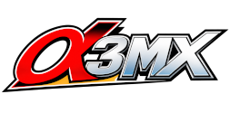

# a3mx


a3mx is a source decompilation of Street Fighter Alpha 3 MAX (PSP): the game rewritten, function by function, as readable C, running natively on PC.

## Vision

The end goal is a responsive, accurate and convenient way to play the game on modern platforms, with some extensions.

## Roadmap

The road map for version 1.0:

- 100% decompilation
- Stable local experience on PC platform

For more, see the roadmap: [docs/ROADMAP.md](docs/ROADMAP.md).

### Decomp

<!-- progress:start -->
```
Overall  [███░░░░░░░░░░░░░░░░░░░░░░░░░░░░░░░░░░░░░]  8.54% decompiled

Functions                                [░░░░░░░░░░]   8.99%  1,338 / 14,881 functions
Instructions                             [░░░░░░░░░░]   8.54%  41,330 / 484,213 instructions

By area (instructions):
  game (modes, menus, fighters, battle)  [█░░░░░░░░░]  18.81%  38,354 / 203,929
  wireless (ad-hoc) VS                   [░░░░░░░░░░]   2.36%  88 / 3,721
  game (to be mapped)                    [░░░░░░░░░░]   0.70%  1,788 / 257,012
  system: save data, graphics, music     [░░░░░░░░░░]   0.16%  4 / 2,574
  system: C library, sound, OS glue      [░░░░░░░░░░]   6.46%  1,096 / 16,977
```
<!-- progress:end -->

The overall bar is the share of the program's instructions that is now hand-written C. Every decompiled function is verified by the tests before it is merged: see [docs/TESTS.md](docs/TESTS.md).

## Prerequisites

> [!IMPORTANT]
> A3MX requires you to own a legally obtained copy of Street Fighter Alpha 3 MAX (PSP) (ULUS-10062). No game is included: you build it from your own disc. Do not support piracy, support your second-hand retro shops instead!

- Windows 10 (1803 or later) or 11 (x64), Linux (x64) or macOS 11 or later (Apple Silicon)
- Your own Street Fighter Alpha 3 MAX PSP disc image (ISO), US release `ULUS-10062`
- On Linux, a few packages from your distribution: the launcher's **Dependencies** tab lists any that are missing, and the line that installs them is in [docs/BUILDING.md](docs/BUILDING.md#tools)
- An internet connection for the first build
- ~2 GB of free disk space to download and use build tools to enable you to build your image

## How to play (Quick guide)

1. Download the latest release for your system from the [Releases](https://gitlab.com/theweathervane-group/a3mx/-/releases) page.
2. Unzip it into a folder of your choice.
3. Open `a3mx-launcher.exe` (Windows), `a3mx-launcher` (Linux) or `A3MX Launcher.app` (macOS).
4. Follow the prompts, and download the build tools if asked.
5. Choose your own disc image on the **Paths** tab.
6. Set any options, then press **Run**: the launcher builds the game and starts it.

The first build takes a few minutes; after that, Run starts the game much more quickly. The detailed
guide, including building from a clone: [docs/BUILDING.md](docs/BUILDING.md).

## Documentation

Please refer to the [docs folder](docs) for more details.

## Acknowledgments

The projects that inspired this one, others working on Street Fighter Alpha 3, and the code and
tools it's built with, for more details see [ACKNOWLEDGMENTS.md](ACKNOWLEDGMENTS.md).

## Licence

The project's own code is licensed under the **GNU General Public License v3.0 or later** ([LICENSE](LICENSE)).
It covers the tools, runtime, decompiled code and documentation only and grants nothing over the game
itself.

## Legal

You must own the game. Disc images, extracted files, assets and generated code are never committed.
Not affiliated with Capcom. *Street Fighter* is a trademark of Capcom Co., Ltd.
