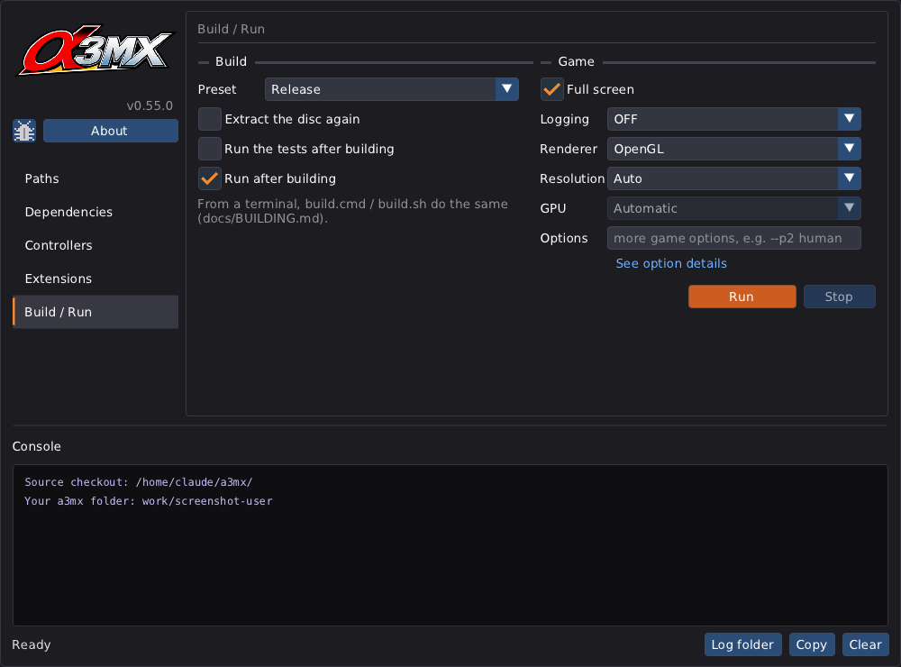
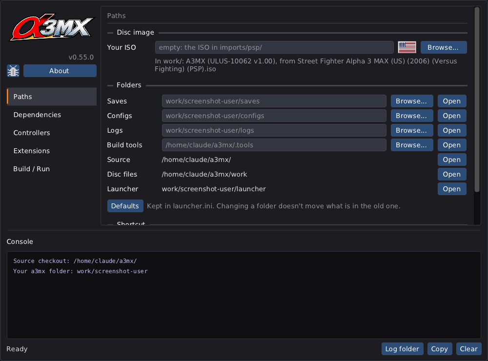
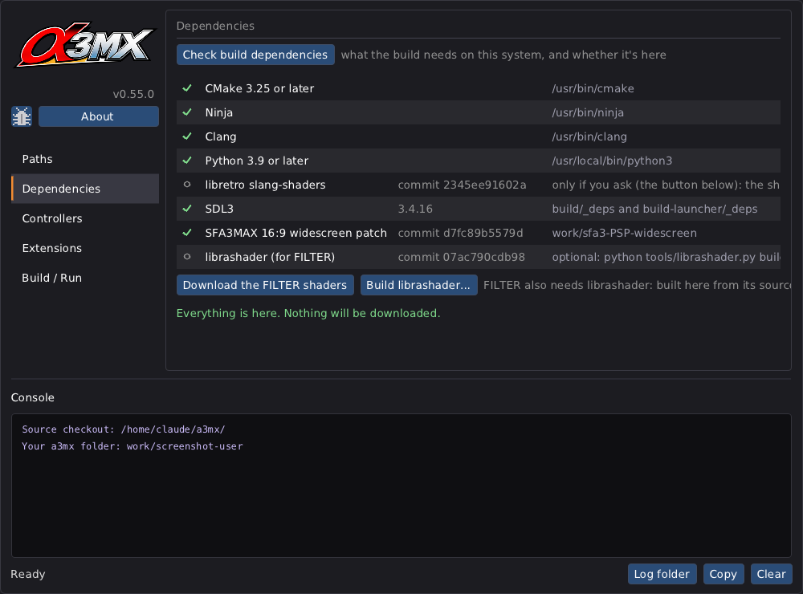
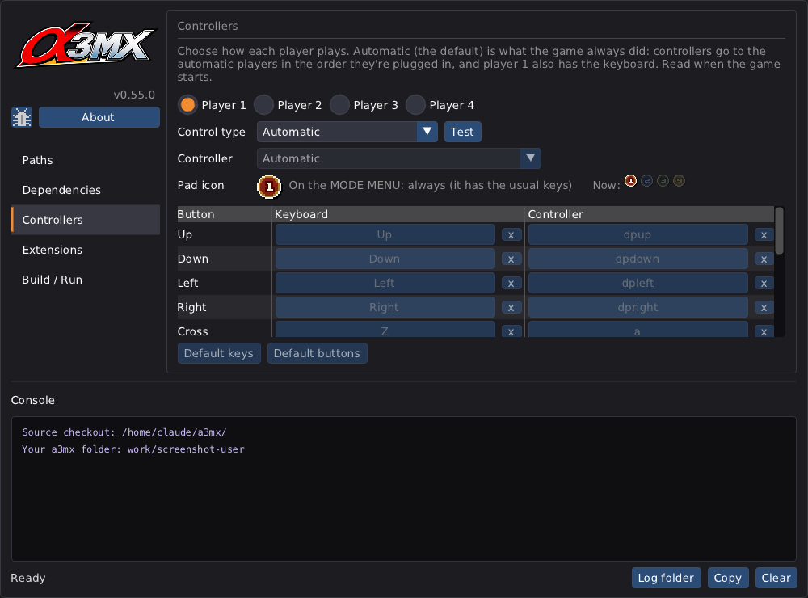
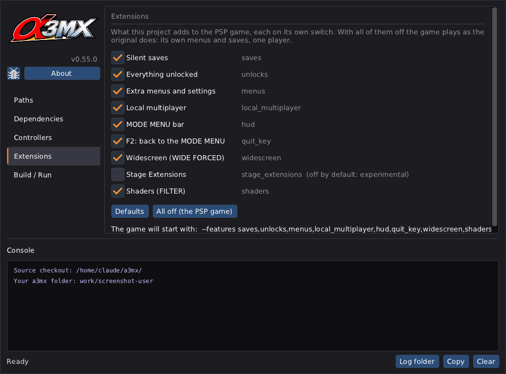

# Building (developers)

Players: the [README](../README.md#how-to-play-quick-guide) is all you need. This page is for working on the decomp:
the tools, every option, and the day-to-day loop.

## Tools

CMake 3.25+, Ninja and Clang, and Python 3.9+, on every system. No Visual Studio and no PowerShell.

- **Windows:** nothing to install. `build.cmd` downloads Python (if you have none), LLVM-MinGW,
  CMake and Ninja into `.tools\` the first time, each pinned to a release (and checked against its
  SHA-256). It uses your own Python only if it is 3.9+ and can verify HTTPS certificates; a Python
  that another program put on the PATH without a certificate store (Inkscape's, for one) is passed
  over for the one in `.tools\python`. If a download still can't verify a certificate, the tools
  fall back to Windows' own `curl.exe` (`tools/fetch.py`).
- **Linux:** your distribution's packages, with SDL3's development libraries for the window and sound:
  ```
  sudo apt install cmake ninja-build clang python3 pkg-config libx11-dev libxext-dev libxrandr-dev libxcursor-dev \
       libxi-dev libxss-dev libxkbcommon-dev libwayland-dev wayland-protocols libegl-dev libgl-dev \
       libasound2-dev libpulse-dev libudev-dev libxtst-dev libxfixes-dev
  ```
  `tools/build.py` checks for these with pkg-config before CMake runs (the window needs X11 or Wayland,
  the sound ALSA, PulseAudio or PipeWire) and stops with this line and the Fedora and Arch equivalents
  when something is missing, as the launcher's **Dependencies** tab lists them. For tests only, the
  `headless` preset needs none of SDL's libraries.
- **macOS:** `xcode-select --install` (Apple's command line tools: Clang, the SDK, Python 3). CMake and Ninja are
  downloaded into `.tools/` the first time, pinned and checked like Windows' (0.52.0).
- **VS Code** (optional): open the folder and accept the recommended extensions (CMake Tools, clangd).
  The build tasks (`Ctrl+Shift+B`) run `build.cmd` / `build.sh`; CMake Tools uses the presets.

## First build

```
git clone https://gitlab.com/theweathervane-group/a3mx.git
cd a3mx
# copy your ISO(s) into imports/psp/ (any name: discs are recognised by checksum)
./build.sh --run                          # build.cmd --run on Windows
```

Or open **the launcher** (below) and press Run.

`build.cmd` / `build.sh` run `tools/build.py`: tools, then `tools/extract_assets.py` (the first time),
then `cmake --preset release` and `cmake --build --preset release`. Just before CMake, any file in the
folder dated in the future (unpacked on a PC whose clock or time zone is behind) is dated now, or Ninja
would never find the build up to date; your ISOs, `assets/` and `saves/` are left alone. By hand, with the tools on your
PATH:

```
python tools/extract_assets.py            # US, into work/
cmake --preset release                    # configure: build/ (downloads SDL3 once)
cmake --build --preset release
ctest --preset release
build/a3mx --work work
```

## The launcher

One window over the same build, for when you'd rather click than type. A release's download for your
system has it prebuilt: open `a3mx-launcher` in the unzipped folder ([below](#ci-and-releases)). In a
clone, `launcher.cmd` / `./launcher.sh` builds it into `build-launcher/` (it needs neither the disc nor
Python's analysis tools), then opens it; after that, `build-launcher/a3mx-launcher` opens it directly
(a normal build also puts one in `build/`, beside the game).

It is the only launcher (since 0.60.0 it also does what `create-launcher` did), and it makes no
shortcut unless you ask. Nothing compiled is committed to the repository.



| Part | What it does |
|---|---|
| left | the project's picture, the version right-aligned under it (`VERSION`, the one EX. SETTING shows), the **bug** icon (a new issue on GitLab, filled in: [below](#reporting-a-problem-from-the-launcher)) and **About**, then the tabs. The colours follow the system's light or dark setting. |
| **Paths** | **Your ISO**, typed or picked with **Browse...** (empty: the US one in `imports/psp/`), with the disc's flag from its program's checksum; only the US disc builds. The folders for **Saves**, **Configs**, **Logs** and the **Build tools**: each can be typed or browsed for, **Open** shows it, and **Defaults** puts every path back. They're kept in `launcher.ini`; changing a folder doesn't move what was in the old one. **Create a Desktop shortcut** / **Start menu shortcut** make one only when pressed.  |
| **Dependencies** | **Check build dependencies** lists what the build needs on this system (from `tools/data/pins.json`) with a green tick for each one that is here (on Linux, also pkg-config and the window and sound
libraries, which come from your package manager). Anything missing is listed with its address, its SHA-256 and the folder it goes into, and nothing is downloaded until you press **I agree** (asked again only if the pinned list changes). Run or Build with something missing sends you here first. The FILTER setting's shaders are a separate button, only if you want them.  |
| **Controllers** | Bring your own device: for each of four players a **Control Type** (Automatic, Keyboard, Controller, Keyboard/Controller, None), the keys and controller buttons, the pad icon, and **Test**, which shows the pad icon beside each button pressed ([CONTROLLERS.md](CONTROLLERS.md)).  |
| **Extensions** | Every extension on its own switch (`--features`, [below](#without-the-extensions)); all off is the PSP game as it was. Widescreen and Stage Extensions (Custom Assets before 0.60.0) are here.  |
| **Build / Run** | the preset (Release / Debug), Extract the disc again (`--extract`), Run the tests (`--test`), Run after building; Full screen, Logging (`--log-level`), Renderer, Resolution (`--scale`), GPU, extra options. **Run** builds what changed and starts the game (F5); unchecked **Run after building**, it says **Build**. **Stop** ends a build or a download. |
| **Console** | at the bottom on every tab: `build.py`'s and the game's output as it comes, whichever tab started it. Drag the bar above it to resize. Everything is also written to `logs/launcher.log` (the previous session's is `launcher.log.1`). **Log folder**, **Copy** and **Clear** are in the bottom right corner. |

**Renderer:** OpenGL and Software work. Vulkan, DirectX 12 (Windows) and Metal / MoltenVK (macOS) are
listed and say "not available yet": choosing one runs OpenGL and the game's log says so. They're
planned as one SDL3 GPU backend.

The buttons run `build.cmd` / `build.sh` with those options (the console shows the exact command), so
the launcher and the command line always build the same way. The choices are kept in
**`launcher/launcher.ini`** in your a3mx folder ([SAVES.md](SAVES.md)); one from before 0.60.0
(`saves/launcher.ini` in the checkout) is read once. Closing the launcher while something runs asks
first, then stops it.

### Reporting a problem from the launcher

The bug icon opens a new issue on GitLab with the version, your system, the disc's serial, the
launcher's settings, the last run's renderer and frame times and the end of its console filled in.
The log file itself has to be dragged in by hand (**Log folder**); a whole log doesn't fit in a link.
Set **Logging** to INFO or DEBUG first, or the log stays empty. What to include:
[REPORTING_ISSUES.md](REPORTING_ISSUES.md).

### Testing the launcher

`a3mx-launcher --settings FILE` uses another settings file, `--user-dir DIR` another a3mx folder,
`--theme light|dark` overrides the system's setting, `--tab paths|dependencies|controllers|extensions|run`
opens on that tab, `--show options|about` opens that window, `--autostart` presses the button once, and
`--screenshot OUT.bmp --frames N` saves the window after N frames and quits (stopping what it
started). The screenshots here were made that way (without a screen on Linux: `SDL_VIDEODRIVER=offscreen`).

### Screenshots

Every screenshot in the documentation is listed in [tools/data/screenshots.json](../tools/data/screenshots.json),
with what it shows and the source files it depends on, and is taken by the launcher itself
(`--screenshot`), so it can be taken again exactly: [launcher-dark.png](images/launcher-dark.png) and
[launcher-light.png](images/launcher-light.png) (Build / Run, default settings), and one of each other
tab ([paths](images/launcher-paths.png), [dependencies](images/launcher-dependencies.png),
[controllers](images/launcher-controllers.png), [extensions](images/launcher-extensions.png)).

- `python tools/screenshots.py` takes every one, or `python tools/screenshots.py ID` one of them; it
  turns the launcher's BMPs into PNGs and records a hash of their sources.
- `python tools/screenshots.py --check` fails if any is out of date (its sources changed since it
  was taken: the launcher's source, or the downloads in `pins.json`), is missing, or isn't linked
  from any document, and if `docs/images/` holds an image not in the list.
- **The rule:** a change to what a screenshot shows takes it again in the same change, and `--check`
  passes before every release (CONTRIBUTING.md). A new screenshot goes in `screenshots.json` with
  the command that takes it.

The launcher holds no game code (SDL3 and Dear ImGui only: [acknowledgments](../ACKNOWLEDGMENTS.md)). Copied
next to a game with no source checkout around it, it offers only Run, which starts `a3mx` beside it
with `--work work` and the Game options: a start for the download-and-run releases of
[phase 8](ROADMAP.md#phase-8-build-and-release-process).

## Presets (CMakePresets.json)

| Preset | Folder | |
|---|---|---|
| `release` | `build/` | the game |
| `debug` | `build-debug/` | with debug info, unoptimised |
| `headless` | `build-headless/` | no window or sound (`A3MX_SDL=OFF`): tests, and machines without SDL's libraries |
| `launcher` | `build-launcher/` | only the launcher (`A3MX_LAUNCHER_ONLY`): no disc or Python needed |
| `ci` | `build-ci/` | no disc (`A3MX_DISC_FREE`): compiles every hand-written file against a stand-in for the generated code and runs the tests that need no game data; what CI runs |

## `build.cmd` / `build.sh` (tools/build.py)

| Option | What it does |
|---|---|
| `--run` | start the game after building |
| `--preset release\|debug\|headless` | which build (default `release`) |
| `--iso PATH` | your ISO, if it is not in `imports/psp/`; extracted again only if it is not the disc already in `work/` (or the widescreen choice changed) |
| `--extract` | extract the disc again (after changing the analysis tools) |
| `--no-widescreen` | extract without the 16:9 patch (no WIDE FORCED) |
| `--no-extensions` | build without the extensions (the PSP program alone) into `<preset folder>-noext/`, e.g. `build-noext/` ([below](#without-the-extensions)) |
| `--test` | run the tests after building |
| `-- ARGS` | with `--run`, everything after `--` goes to the game, e.g. `./build.sh --run -- --log-level debug` |
| `--launcher` | build the launcher (preset `launcher`) and open it; what `launcher.cmd` / `launcher.sh` do |
| `--clean` | start from nothing, then carry on as usual. It deletes every `build` / `build-*` folder, what's in `.tools/` and what's in `work/` first. **Kept in `.tools/`**: `librashader/`, any `librashader-*` source folder and `slang-shaders/` (FILTER's library and shaders: slow to make again, and the library may be one you built yourself). Never touched: your a3mx folder and `saves/` ([SAVES.md](SAVES.md)), `imports/` (your ISOs), `assets/`, the code. With `--launcher` (`launcher.cmd` / `.sh`) it deletes `build-launcher/` too; without, it stays. Close the game and the launcher first. |
| `--clean-all` | as `--clean`, and deletes those kept folders too: all of `.tools/` |
| `--librashader` | only build FILTER's library from its pinned source (`tools/librashader.py`; needs Rust), then stop. `--install-rust` installs Rust first if it isn't there (rustup, for your user only). The launcher's **Dependencies > Build librashader...** does the same |
| `--tools-only` | only fetch / check the tools |

## CI and releases

The pipeline is GitLab's (`.gitlab-ci.yml`); the GitHub mirror runs the same jobs (below). It has no disc, so it builds the disc-free `ci` preset
(every hand-written file compiled, the tests that need no game data run) and the launcher, on
Windows, Linux and macOS. The parity tests need the disc, so they stay on developers' machines: run
them (`ctest`, or `build.sh --test`) before committing.

It runs when started by hand (**Build > Pipelines > New pipeline**) and for a tag `v<VERSION>`. Not
on every push. Releases are made by hand; the GitHub mirror also makes a nightly (below).

| Stage | Jobs | What |
|---|---|---|
| check | `pins` | `tools/pins.py --check` (every pin agrees, DEPENDENCIES.md current), `release_notes.py --check`, the Python tools compile |
| build | `build:linux-x64`, `build:windows-x64`, `build:macos-arm64` | the `ci` preset and `ctest`, the build without the extensions, then the downloads below |
| release | `release` (tags only) | uploads the downloads to the project's package registry and makes the GitLab release, with notes from CHANGELOG.md |

The Windows and macOS jobs need GitLab's hosted runners for those systems (`saas-windows-medium-amd64`,
`saas-macos-medium-m1`), or your own with those tags. macOS is `allow_failure`, so a release doesn't
wait for it: if it passes, its download is added to the release. **This pipeline was written without
a GitLab runner to try it on: run it by hand once and read each job's log before trusting it with a
release.**

### The GitHub mirror

GitLab is the project's home; `main` and the tags are mirrored to GitHub. `.github/workflows/ci.yml`
(with `build.yml`, one system's build) runs the same jobs there: by hand (**Actions > CI > Run
workflow**) and when a tag `v<VERSION>` arrives, which makes the GitHub release from that commit's
builds, with the same notes and downloads. It never runs for a push to `main`, never on a schedule,
and never makes a tag itself: tagging on GitLab is still the one way to release. A change to a job in
`.gitlab-ci.yml` belongs in the workflow too. The actions it uses are pinned by commit.

### Built once and kept

Three things take time and rarely change, so each build job keeps them in its cache under `.tools/`,
keyed on `tools/data/pins.json` and the script that makes them:

| What | Made by | Kept in |
|---|---|---|
| SDL3, compiled as a static library | `python tools/sdl3.py` | `.tools/sdl3/` |
| librashader (FILTER's library), compiled with Rust | `python tools/librashader.py` | `.tools/librashader/` |
| FILTER's shaders, downloaded and checked | `python tools/shaders.py` | `.tools/slang-shaders/` |

Each script does nothing when its folder is already right, so a run only makes again what a changed
pin or script asks for. `cmake/SDL3.cmake` uses `.tools/sdl3/` when it is there and otherwise compiles
SDL3 inside the build folder, so nothing changes for a build that never ran `sdl3.py`. librashader
goes into every download (`package_launcher.py --librashader`); if its build fails the pipeline carries
on and that download goes out without it. The same three commands work on your own PC.

### The downloads

Each build job makes two files, named by version and system:

- `a3mx-<version>-<system>.zip`: the source tree (`git archive`) with the **prebuilt launcher** at its
  top and an empty `imports/psp/` for the ISO. This is what a player unzips and opens: the launcher
  finds `tools/build.py` beside it, so they pick their ISO and press Run.
- `a3mx-launcher-<version>-<system>` (`.exe` on Windows, a `.zip` holding the `.app` on macOS): the
  launcher alone.

`<system>` is `windows-x64`, `linux-x64` or `macos-arm64`. Shipping the launcher is allowed because it
holds no game code; the game itself is always built on the player's machine from their disc. To make
a zip by hand: `python tools/package_launcher.py --system linux-x64 --launcher build-launcher/a3mx-launcher --out dist`.
`launcher.cmd` / `launcher.sh` open the prebuilt launcher when it is there, and build one otherwise.

### Releasing

1. Raise `VERSION` (MAJOR.MINOR.PATCH) and add its section at the top of `CHANGELOG.md`: one bullet
   per change, a bold lead then what a player will notice (`python tools/release_notes.py --check VERSION`).
   Committing that does **not** release anything.
2. `python tools/screenshots.py --check` passes, so the documentation's screenshots show what is
   being released.
3. The maintainer tags that commit on `main` as `v<VERSION>` and pushes the tag. The pipeline checks
   that the tag is `VERSION`, builds and tests all three systems, and once Windows and Linux pass,
   the `release` job publishes the release with their downloads and notes covering every changelog
   section since the previous release.

Tags are made only by the maintainer, only on `main`. To preview a release's notes:
`python tools/release_notes.py 0.55.0 --since 0.52.0`.

### Nightly (GitHub)

The GitHub mirror makes a nightly; GitLab's is switched off. Every night at 02:47 UTC, if `main` has
changed since the last nightly, GitHub Actions builds it exactly as for a release, with `VERSION`
stamped `<VERSION>-nightly.<YYYYMMDD>+<commit>` (for example `0.64.0-nightly.20261113+0ebcb8b1`), and
publishes it as the pre-release **nightly**, replacing the previous one. It is never marked latest, so
players are still sent to the supported release. To make one by hand: **Actions > CI > Run workflow**,
on `main`, with **nightly** ticked. The stamp means the launcher's corner, the game's boot screen and
log, and the bug report all say it is a nightly. EX. SETTING shows `V0.64.0-NIGHTLY.20261113`: its font
has no `+` or lower case, so the commit is left off. File names use `.` for the `+`.

The `nightly` tag exists only on GitHub, so the GitLab push mirror must have **Keep divergent refs**
on; otherwise every mirror push deletes the tag and GitHub turns the release back into a draft until
the next nightly. (It is a checkbox when the mirror is created, and afterwards only changeable through
GitLab's remote mirrors API.)

GitLab can make one too: put the `schedule` rule back in `.gitlab-ci.yml`'s `workflow:` (the comment
there shows it) and add a schedule under **Build > Pipeline schedules**. A GitLab nightly makes no
release: its downloads are the build jobs' artifacts, kept for two weeks.

## The loop

After the first build, decompiling or editing code is:

```
cmake --build --preset release    # re-translates if src/core or tools changed; compiles what changed
ctest --preset release            # parity: every scenario, originals against decompiled code
```

Re-run `tools/extract_assets.py` only for a different disc or after changing the analysis tools.
`python tools/pac.py list|unpack|pack` works on single archives ([PAC_FORMAT.md](PAC_FORMAT.md)).
`python tools/pair_palettes.py census` then `pair` remakes `tools/data/palette_pairs.json`, which says
where each indexed texture's colours are (an hour of headless runs; only after a change that could
move them).
`python tools/progress.py --by-region` shows how far the decomp is; `--list` which functions the
last test run verified. `python tools/show_func.py ADDR` shows a function's translation.

How to decompile a function, and what to do when parity fails: [DECOMPILING.md](DECOMPILING.md).

## `tools/extract_assets.py`

| Option | |
|---|---|
| `--region us` / `--region jp` | which disc (default `us`). JP goes to `work-jp/` and is not buildable yet. |
| `--iso PATH` | the ISO, instead of searching `imports/psp/` (also `A3MX_ISO`) |
| `--work DIR` | output folder |
| `--no-widescreen` | leave out the 16:9 patch (no WIDE FORCED) |
| `--verify-only` | check the disc and stop |
| `--no-pac` | do not unpack the `.pac` archives into `assets/` |

## CMake options

| Option | Default | |
|---|---|---|
| `A3MX_WORK_DIR` | `work` | the folder `extract_assets.py` wrote |
| `A3MX_ASSETS_DIR` | `assets/us` | the unpacked assets the `asset_pac` and `assets_in_game` tests use |
| `A3MX_SDL` | ON | window, input and sound through SDL3 (downloaded once). OFF: headless only |
| `A3MX_EGL` | OFF | headless OpenGL through EGL (Linux tests of the GPU renderer) |
| `A3MX_WATCH` | OFF | memory watchpoints (`--watch LO-HI`); slower |
| `A3MX_TESTS` | ON | parity tests in `ctest` |
| `A3MX_EXTENSIONS` | ON | the extensions from the static recomp (`src/extensions/`). OFF: the PSP program alone ([below](#without-the-extensions)) |
| `A3MX_LAUNCHER` | ON | the launcher (`a3mx-launcher`) beside the game, when `A3MX_SDL` is ON |
| `A3MX_LAUNCHER_ONLY` | OFF | only the launcher: no disc, no Python (the `launcher` preset) |
| `A3MX_DISC_FREE` | OFF | no disc: compile the hand-written code (not linked) and run the disc-free tests (the `ci` preset) |

## Command line (the game)

| Option | |
|---|---|
| `--work DIR` | the work folder made by `extract_assets.py` |
| `--no-extensions` | run without the extensions: the PSP program alone ([below](#without-the-extensions)) |
| `--features LIST` | which extensions are on, comma separated: `saves`, `unlocks`, `menus`, `local_multiplayer`, `hud`, `quit_key`, `widescreen`, `stage_extensions`, `shaders`, or `all`, `none`, `default`; `-NAME` turns one off (`default,-hud`). The launcher's **Extensions** tab writes this |
| `--custom-assets` | before 0.60.0: the `stage_extensions` feature (the project's own art in `assets/extensions/`) |
| `--assets DIR`, `--no-assets` | load each archive that `DIR/index.json` gives a folder from it (default: `assets/<region>` beside the work folder); or everything from the disc ([ASSET_LOADING.md](ASSET_LOADING.md)) |
| `--renderer gl\|soft\|none\|lazy` | GPU renderer (default), software reference, nothing, or only dumped frames |
| `--scale N` | GPU internal resolution, N × 480×272 (1–8). Default: enough to cover the monitor's height, at most 4 (1088 rows), and 1 on a software OpenGL (llvmpipe). The GPU's work grows with N²; the game's doesn't change |
| `--filter NAME` | overrides SCREEN SETTING > FILTER for this run (`off`, `crt-curved`, `scan-light`, `xbrz`, ...; [DISPLAY.md](DISPLAY.md)). `--librashader FILE` / `--shaders DIR` use that library / shader folder |
| `--frame-timing auto\|smooth\|original` | overrides SCREEN SETTING > FRAME TIMING for this run ([DISPLAY.md](DISPLAY.md)) |
| `--perf-log FILE` | one CSV row per frame: its time split into game, render (and textures), present, idle, the GPU's own time and the wait for vsync (swap), and how long since the last frame reached the screen. Every run also logs a summary every 600 frames (INFO) and at the end, and writes it to `logs/last_run.txt` for the launcher's bug report |
| `--p2` / `--p3 human\|cpu\|auto` | who controls fighters 2 and 3 (auto: a human if gamepad 2 / 3 is connected) |
| `--pads 124` | treat those gamepads as plugged in (the pad icons; tests) |
| `--fullscreen` / `--windowed` | open full screen (the default: the desktop's own resolution, no mode change) or in a window; F11 or Alt+Enter switch while playing |
| `--headless`, `--frames N`, `--fast` | no window or sound; quit after N frames; do not wait for the clock |
| `--input "200=up;206=;220=cross;226="` | scripted buttons by frame (`p2:` / `p3:` for the other pads) |
| `--dump DIR`, `--dump-every N`, `--dump-from F` | save the screen as PNG |
| `--hash-log FILE` | per frame: hash of the program's memory and of the frame buffer |
| `--user-dir DIR` | your a3mx folder: `saves/`, `configs/`, `logs/` and `launcher/` in DIR (default: the system's per-user folder, e.g. `%APPDATA%\a3mx`; [SAVES.md](SAVES.md)) |
| `--dir-saves` / `--dir-configs` / `--dir-logs DIR` | one of those folders somewhere else (the launcher's **Paths**) |
| `--save-dir DIR` | saves and settings together in DIR, the log in `work/` (the tests). `--save-fails` makes every save fail, `--save-questions` keeps the game's own save questions (tests) |
| `--reference` | every decompiled function runs as its translated original |
| `--reference-only A,B` | only these (hex addresses) run as the original |
| `--decomp-report FILE` | how many times each decompiled function ran |
| `--difftest [N]` | test decompiled functions against their originals on N random inputs each, then quit |
| `--stick "F=LX,LY;..."` | scripted analogue stick by frame |
| `--io-faults busy=N,error=N,poll=N,read=N` | a misbehaving disc: every Nth async read busy (two in a row) or failing, poll not finished, plain read failing |
| `--snap FRAME:FILE`, `--poke FRAME[-END]:ADDR=VALUE[/SIZE]` | save memory at a frame / set it every frame from FRAME (to END) |
| `--palette-census FILE` | record each indexed texture drawn and the colours it is drawn with (`tools/pair_palettes.py`) |
| `--log-level off\|error\|warn\|info\|debug\|verbose` | how much goes to the console and the log (default `info`, as before). Warnings, errors and debug lines start with `WARN: `, `ERROR: `, `DEBUG: `; `verbose` adds every OS call (as `--trace`); `off` writes only a fatal error |
| `--record-audio DIR`, `--trace`, `--log FILE` | audio channels as WAV; log every OS call; log elsewhere |
| `--net-hub PORT` / `--net-join PORT N` | link separate instances over TCP (tests) |

## Without the extensions

The extensions carried over from the static recomp (`src/extensions/`) can be left out, to play or test
the game as the PSP program alone, decompiled and translated code only:

- **At run time:** `build/a3mx --work work --no-extensions`, with any build.
- **At build time:** `./build.sh --no-extensions` (`build.cmd --no-extensions` on Windows) builds into
  `build-noext/`; by hand, `cmake --preset release -B build-noext -DA3MX_EXTENSIONS=OFF` then
  `cmake --build build-noext`. `src/extensions/` is not compiled, `tools/data/hooks.txt` is ignored
  (every hooked function is translated as itself) and the program always runs as `--no-extensions`.

Either way:

| | With the extensions | Without |
|---|---|---|
| Hooked functions (`hooks.txt`) | the hook (`hook_f_ADDR`) | the translated original |
| Wrapped functions (`SFA_FUNC_WRAPPED`) | the function with its extension around it | the function alone |
| Saves | `a3mx.dat` / `a3mx.cfg`, auto-save on, everything unlocked, save messages silent | the game's own, on the emulated memory stick (`<save dir>/ms0/PSP/SAVEDATA/`), with its own messages and questions; nothing unlocked |
| OPTION MODE | EX. SETTING, PLAYER CONFIG P4, L2 / R2, IMPORT / EXPORT, WIDE FORCED, VSYNC | the game's five buttons, two screen sizes, no VSYNC row (vsync ON) |
| Pads | up to four; join-in, JOIN / WAIT, pad icons | player 1's pad only, as on a PSP; no L2 / R2 |
| Network modes | played on one PC with virtual players | as a PSP's ad-hoc wireless: only other instances linked with `--net-hub` / `--net-join` answer |
| F2 | back to the MODE MENU | nothing |

The settings file `a3mx.cfg` is neither read nor written without the extensions, so a faithful run
leaves a normal one's settings and saves alone. The parity tests run both ways (`parity_*`, and the
`no_extensions` scenario).

## What is where

| Folder | What | Safe to delete? |
|---|---|---|
| `imports/psp/` | your ISOs | yours |
| `.tools/` | downloaded build tools and Python (Windows) | yes: downloaded again |
| `saves/`, `configs/`, `logs/`, `launcher/` | only if your a3mx folder can't be written: **your saves and settings** are normally in `%APPDATA%\a3mx` and its equivalents ([SAVES.md](SAVES.md)) | no: kept by `--clean` |
| `work/`, `work-jp/` | the disc's files and the analysis (saves were here before 0.44.0, and are moved to your a3mx folder once) | yes: extracted again |
| `assets/<region>/` | extracted assets; **your edits**, which the game loads | yes, if you have not edited anything: extracted again |
| `build*/` | the CMake builds (one per preset), `generated/` (translated code) and `parity/` (test runs) | yes |

All of these are git-ignored and must never be committed.
